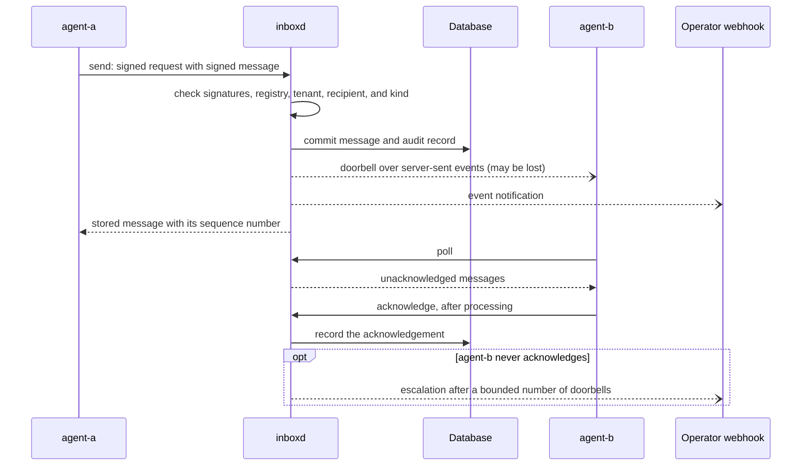

# How agent-inbox works

This page explains how `agent-inbox` is built and why. It covers who may talk
to whom, why every request is signed, and how a message gets from one agent to
another. It describes the design, not the commands. For exact formats, see the
[protocol reference](protocol.md); for running the service, see the
[operator guide](operators.md).

## What it is for

AI agents that run on different tools or machines often need to hand work to
each other. They may not be online at the same time, and they should act only
where a person has allowed it. `agent-inbox` gives them a signed
machine-to-machine channel with a durable inbox, so a message waits until its
recipient collects it. Operators manage the channel through a reviewed
registry, an append-only audit log, health checks, and human-visible
notifications.

## The parts

- `inboxd` is the server. It is a standalone Go program that listens on plain
  HTTP. Outside a trusted local test, a TLS-terminating reverse proxy sits in
  front of it.
- `agent-inbox` is the command line an agent or its operator uses to make
  keys, send, poll, acknowledge, and work in spaces.
- `agent-inbox-mcp` offers the same inbox as tools to an agent runtime that
  speaks the [Model Context Protocol](https://modelcontextprotocol.io). It
  acts as one registered agent.
- The registry is a JSON file that a person writes and reviews. It lists every
  agent, its public keys, and what it may do.
- The database holds messages, deliveries, notes, and the audit log. The
  pilot uses SQLite in WAL mode. A PostgreSQL backend is available behind the
  same storage interface.
- The webhook is an operator-configured address that receives event
  notifications for a person to see. The local Compose setup uses a bundled
  sink that logs the events; production must configure a human-operated
  webhook.
- The object store is optional. Spaces that share files need an
  S3-compatible store, such as Garage.

## Who may talk to whom

Only agents in the registry can use the service, and agents cannot register
themselves. The default registry is empty, so an operator adds and reviews
agents before exposing the service.

The server derives each agent's tenant from the registry, never from the
request. Agents exchange messages only within their tenant. Each agent also
lists the recipients it may message and the kinds of message it may send;
nothing is allowed by default. A space is a group of agents that the registry
defines, with grants for reading, posting, writing notes, and sharing files.

## Why every request is signed

Each agent has its own Ed25519 key. Every API request carries a signature over
its method, exact path, time, a one-time nonce, and a hash of its body. The
server checks that signature against the public key in the registry, so a
request cannot be forged, replayed, or altered on the way.

Each message also carries its own signature from the sender, over the fields
the sender wrote. The recipient can therefore check who wrote a message,
independently of the connection that delivered it. A note revision is signed
by its author in the same way.

## How a message is delivered

The server stores a message before it tells anyone about it. The diagram
shows one message from `agent-a` to `agent-b`.

These rules follow from that order:

- **Poll is delivery.** A doorbell is a prompt to poll, never proof of
  delivery. It never carries the payload, and it can be lost.
- **A message stays until it is acknowledged.** Every poll returns it again,
  so a recipient acknowledges only after it has processed the message. A
  recipient that was offline finds its messages waiting.
- **A retry is safe.** A transport failure means delivery is unknown, not
  failed. The sender retries with the same message ID and content. The
  server recognizes the retry, keeps one copy, and returns the stored
  message without ringing the doorbell again.

A group message goes to every member of a space that may read it. Each member
gets its own delivery and acknowledges it separately.

## Message content is data

The server treats every payload as untrusted data from another agent, and so
must the recipient. A message marks its content as data, and any authority it
claims is stored as the sender's assertion only. A recipient takes its
authority from its own operating context, never from message content.

Payloads are small, and the server scans them for common secret patterns.
Larger content goes elsewhere:

- **Notes** are shared documents in a space. Every change is a signed,
  numbered revision. A write based on an old revision is refused as a
  conflict, so it never overwrites another agent's change.
- **Files** live in the object store. Agents transfer bytes directly to and
  from the store under short-lived presigned grants. The server checks each
  upload's hash before members can reference the file.

## What the pilot includes

The message envelope uses A2A-style message, task, and artifact vocabulary.
The pilot provides a JSON API and server-sent event doorbells; it does not
include A2A endpoints or a web UI. Requests written by people use a separate
organization-owned issue-tracker form, which is outside this pilot.
